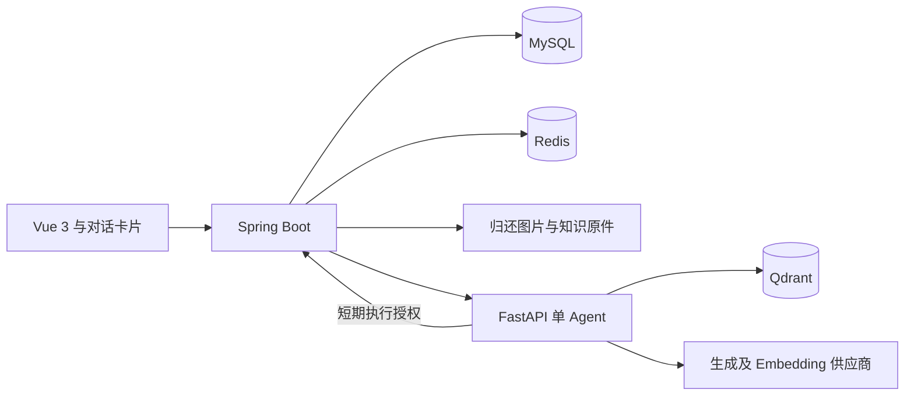

# 服务与权限架构

浏览器仅调用同源 `/api`；Java 后端负责认证、权限、业务事务、文件、消息、统计和 AI 执行记录。Python 通过内部 HTTP 提供模型工具循环、文档解析和 Qdrant 索引检索，不能直连业务 MySQL。

Java 采用 Spring Boot 3.5.16、Spring Security、Spring JDBC/JdbcTemplate 和 Flyway。数据访问使用参数化 SQL；未引入 MyBatis，当前集中在 Db 和业务查询服务，避免两套持久化方式混用。Java21、Python3.12、Vue3、FastAPI、LangGraph、Qdrant 等基础版本与参考工程相近，前端锁文件保留参考版本并增加 ECharts。

## 认证与权限

登录返回 256 位随机不透明 Bearer token，Redis 仅保存 token 哈希及账户授权版本，7 天有效，前端放 sessionStorage。每个受保护请求从数据库复核账户、授权版本、多角色和范围。退出撤销当前会话，改密、停用、角色变更使旧会话失效。Redis 不可用时拒绝认证。Redis key 包含数据库名，测试不影响业务会话。

学生按本人记录访问，实验员按实验室管理范围，维修人员按当前指派，管理员按管理角色。列表、单条详情、下载、统计和 AI 工具都执行相同范围检查。角色关联表维护多角色，授权代码在业务方法中显式执行；角色职责固定，不开放任意组合的动态权限编辑。

## 状态与并发

Service 中使用 READ COMMITTED 事务，同设备操作先锁 equipment 主行。借用唯一生成列防止重复占用，单预约唯一键防止重复发放，幂等记录保存相同请求响应。时段统一毫秒精度避免数据库舍入造成相邻预约冲突。

设备手工启停、工单禁借与实物占用分开记录。工单验收只解除对应 equipment_block。通知、事件、核心状态在同事务写入；AI 和索引网络调用在事务外执行。

## AI 执行

请求先保存对话、用户消息和 ai_run，提交后进入 4 个线程、24 个等待项的有界执行器。Python 用 LangChain Core 定义工具，LangGraph 运行单 Agent，模型决定调用只读查询或授权写工具；真实结果生成业务卡片和引用。页面轮询执行记录，重开可查。对话提交按用户和请求键幂等，防止重复触发模型执行。业务已提交而模型后续总结失败时，根据已落库的幂等回执显示实际成功操作，不伪造模型回答。

Java 内部工具要求共享服务密钥、runId、短期授权票据，检查执行中状态、有效时间、用户当前权限与最多 6 次工具预算。ai_access 记录实际读取的工单、借用和知识片段，权限或指派变化后历史结果隐藏，隐藏内容不会继续发给模型。模型 API Key 仅在服务间受控传递，工具参数中没有密钥。

重启标记未完成 AI 执行为 INTERRUPTED，用户可重新发送；不自动重放有费用的模型调用。知识索引有 job_task 记录，重启后明确失败、允许手工重建，不声称支持逐步恢复。当前适合单实例交付，未实现多实例租约调度。

## 知识与文件

上传使用服务端随机路径、文件类型和体积检查，图片验证解码与像素数；文档解压体积、页数、字符数、片段数有上限。文件只通过授权下载接口返回。TXT/Markdown/PDF/DOCX 不执行其中内容，扫描文档不伪装提取成功。

MySQL 保存原文、版本和来源，Qdrant 是可重建索引。不同 Embedding 模型和 demo 使用不同集合，权限过滤与已发布版本 ID 在 top-k 前生效，Java 返回前再核验。新片段和索引结果元数据以事务保存，避免部分替换。

## 部署与可用性

本机脚本管理 Qdrant、AI、Java 和 Vite，复用 MySQL/Redis；Compose 部署 Nginx、Java、Python、MySQL、Redis、Qdrant 六服务。基础业务接口不调用模型；运行时模型或向量服务失效只影响智能/索引功能。启动器保留参考工程的依赖启动顺序。

生产仅发布 Nginx，推荐由服务器入口配置 HTTPS。后端无 AI 就绪依赖，AI 存活检查不访问业务服务，避免健康依赖成环。备份恢复为停机一致性流程，数据库与文件带校验清单，向量索引恢复后重建。
