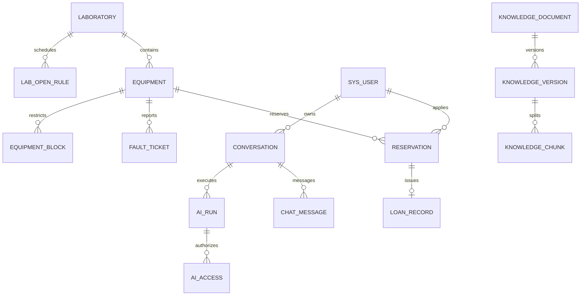

# 数据库实现

当前结构以 `lab-equipment-backend/src/main/resources/db/migration` 的 Flyway SQL 为权威，共 30 张表。初稿的 35 表拆分保存在 archive/DATABASE_DESIGN.md，当前合并事件与范围结构，增加对话、历史开放规则和 AI 访问证据。

主键为服务端 UUID CHAR(36)，时间 UTC DATETIME(3)，金额 DECIMAL，SQL 使用参数绑定。核心外键限制删除，停用代替删除有历史业务的用户和设备。当前只有单台实体预约，不以“库存数量”替代设备身份。

| 分组 | 表 |
| --- | --- |
| 身份与范围 | sys_user、sys_role、sys_permission、sys_user_role、sys_role_permission、lab_staff_scope |
| 实验室与设备 | laboratory、lab_calendar、lab_open_rule、equipment_category、equipment、equipment_block |
| 借还与工单 | reservation、loan_record、fault_ticket、business_event |
| 文件与消息 | file_object、notification |
| 知识 | knowledge_document、knowledge_version、knowledge_chunk |
| 对话与 AI | conversation、chat_message、ai_run、ai_tool_event、ai_access、job_task |
| 公共支持 | idempotency_record、system_setting、audit_log |

## 关键约束

设备 asset_no 唯一；预约 reservation_no 和工单 ticket_no 唯一；loan_record.reservation_id 唯一。未归还记录生成 active_equipment_id，UNIQUE 保证同设备最多一条。归还后列为 NULL，历史记录不互斥。时间重叠无法仅靠唯一索引表达，所有影响可用性的动作先锁 equipment 主行并在 READ COMMITTED 下检查最新区间。

每张工单的 FAULT block 以 source_type/source_id 去重，手工停用每次建立自己的区间。统计对重叠 block 扣除一次。lab_open_rule 保存开放时间生效区间，设备归属不提供普通编辑迁移，避免当前归属覆盖历史统计。

knowledge_document 保存当前发布指针和当前可见范围；knowledge_version 保存不可变正文、型号、类别、范围和发布历史；knowledge_chunk 保留来源定位与向量点 ID。新版本失败不改变发布指针。索引替换的 MySQL 片段和状态以事务保存。

ai_run 保存执行状态、查询、模式、授权票据哈希、工具次数和结果；ai_access 保存本次实际读取的受保护对象。历史展示和后续模型上下文重新检查当前权限。chat_message 保存文字、附件、卡片和引用快照；引用快照不绕过当前权限。

notification 通过用户和 dedupe_key 去重。idempotency_record 用用户/操作/键唯一，保存规范序列化请求哈希和响应。system_setting 中模型密钥使用 AES-GCM，根密钥由环境提供，审计不写密钥。

## 实际字段清单

以下为建表时的字段索引，后续增量列列于迁移说明；完整类型、索引、外键和 CHECK 约束见 SQL。

| 表 | 主要字段 |
| --- | --- |
| sys_user | id, username, password_hash, name, role, enabled, auth_version, created_at |
| sys_role | code, name |
| sys_permission | code, name |
| sys_user_role | user_id, role_code |
| sys_role_permission | role_code, permission_code |
| laboratory | id, name, location, open_start, open_end, enabled, created_at |
| lab_staff_scope | user_id, lab_id |
| lab_calendar | id, lab_id, local_date, is_open, reason |
| equipment_category | id, name |
| equipment | id, asset_no, name, model, category_id, lab_id, purchased_on, description, enabled, version, created_at |
| reservation | id, reservation_no, equipment_id, user_id, lab_id, starts_at, ends_at, purpose, status, reviewed_by, reason, version, created_at |
| loan_record | id, loan_no, reservation_id, equipment_id, user_id, lab_id, issued_by, issued_at, due_at, returned_at, return_note, return_photo_ids, status, checked_by, checked_at, active_equipment_id |
| fault_ticket | id, ticket_no, equipment_id, lab_id, loan_id, reporter_id, title, description, photo_ids, severity, affects_use, status, assignee_id, verified_by, accepted_at, repair_started_at, repair_submitted_at, closed_at, resolution, labor_minutes, cost_amount, version, created_at |
| equipment_block | id, equipment_id, source_type, source_id, reason, starts_at, ends_at |
| business_event | id, business_type, business_id, action, actor_id, note, created_at |
| file_object | id, owner_id, storage_key, name, mime_type, size_bytes, created_at |
| notification | id, user_id, title, content, business_type, business_id, dedupe_key, read_at, created_at |
| knowledge_document | id, title, category, model, lab_id, visibility, enabled, published_version_id, created_by, created_at |
| knowledge_version | id, document_id, version_no, file_id, text_content, status, published, chunk_count, error, created_at |
| knowledge_chunk | id, version_id, chunk_index, text_content, locator |
| conversation | id, user_id, title, created_at, updated_at |
| chat_message | id, conversation_id, role, content, attachments, cards, citations, run_id, created_at |
| ai_run | id, conversation_id, user_id, status, mode, query, photo_ids, context_json, result_json, error, grant_hash, started_at, finished_at |
| ai_tool_event | id, run_id, tool_name, summary, duration_ms, created_at |
| job_task | id, type, business_id, status, error, created_at, updated_at |
| idempotency_record | user_id, operation, idempotency_key, request_hash, response_json, created_at |
| system_setting | setting_key, value_text, updated_at |
| audit_log | id, actor_id, action, target_id, note, created_at |
| lab_open_rule | id, lab_id, open_start, open_end, effective_from, effective_to |
| ai_access | run_id, object_type, object_id |

## 增量迁移

- V1：基础账户、实验室、设备、借还、工单、知识、对话和公共支持。
- V2：lab_open_rule，导入已有实验室开放时间。
- V3：ai_run.tool_calls；知识版本增加 title、model、category、visibility、lab_id、published_at，使发布元数据属于版本。
- V4：ai_access，保存 AI 读取对象用于权限变化后的历史保护。

已经执行的迁移不修改，结构调整继续增加 V5 等迁移。MySQL 是业务事实唯一来源，Redis 只保存可撤销会话和短期状态，Qdrant 为可重建索引。

V7新增 `module_seen(user_id,module_key,fingerprint,seen_at)`，主键为用户与模块，保存该账户最近查看的模块指纹。模块指纹由当前授权对象及其变更记录计算，旧版本确认不会清除后续变化。
