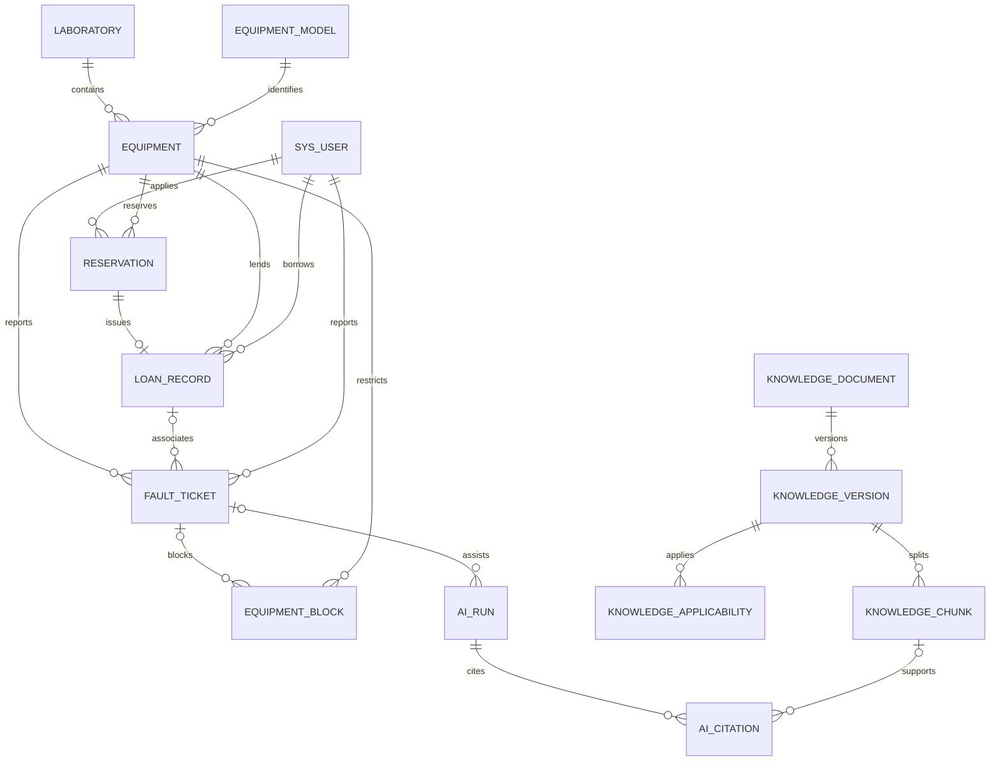

# 数据库设计草案

本文件与 `DESIGN_PLAN.md` 配套，定义逻辑表、关键字段、约束、索引和状态的权威来源。当前没有执行建库或迁移。表名可在编写首批 Flyway 时微调，业务语义和约束不得随意改变。

## 1 通用约定

- 主键 `id CHAR(36)` 为服务端 UUID；外键同型。编码使用 utf8mb4，主键、设备号、工单号、幂等键按明确的区分大小写规则处理。
- 时间为 UTC `DATETIME(3)`；接口带时区。周期按学校 Asia/Shanghai 时区解释后转 UTC 查询。
- 可变记录含 `created_at/updated_at/version`；事件只追加，含 `actor_id/occurred_at/request_id`。历史人名、设备名称等需要展示时保存最小快照，权限仍按当前规则校验。
- 状态使用受约束 VARCHAR 和 Java 枚举，不允许自由字符串。金额 `DECIMAL(12,2)`，数量/秒数用整数，说明用 TEXT，核心关联不用 JSON 代替外键。
- 外键删除采用 RESTRICT；有历史业务的用户、设备、实验室只停用，不直接物理删除。文档删除保留被引用版本的必要快照。
- 业务写入、对应事件、必要消息、审计在同一事务内完成。后台网络调用不在事务里执行。

## 2 身份与实验室

| 表 | 关键字段 | 约束和用途 |
| --- | --- | --- |
| sys_user | username, password_hash, real_name, student_no, enabled, auth_version, must_change_password | username 唯一；student_no 非空时唯一；密码单向哈希；auth_version 变更使旧权限会话失效 |
| sys_role | code, name, enabled | STUDENT/LAB_STAFF/TECHNICIAN/ADMIN 等 code 唯一 |
| sys_permission | code, name, module | 如 reservation:approve、loan:issue、ticket:verify，code 唯一 |
| sys_user_role | user_id, role_id | 二者联合唯一；禁止通过个人信息接口修改 |
| sys_role_permission | role_id, permission_id | 二者联合唯一 |
| laboratory | code, name, building, room, enabled | code 唯一；归档后历史仍可查 |
| lab_staff_scope | lab_id, user_id, enabled | lab_id + user_id 唯一；与 LAB_STAFF 角色共同构成权限 |
| lab_open_rule | lab_id, weekday, local_start_time, local_end_time, effective_from, effective_to | 规则版本化、有效期不重叠；一天可多个时段；跨日按两日拆分 |
| lab_calendar_exception | lab_id, local_date, revision_no, supersedes_id, kind, start_time, end_time, reason | kind=OPEN/CLOSED；同日先合并开放段再扣关闭段；历史修改新建修订，保留原因，不能静默改变历史统计 |

会话本体位于 Redis；用户禁用、角色修改等提交后使会话撤销，并通过 auth_version 复核。Redis 不可用时受保护接口返回认证依赖不可用，不放行匿名业务。

## 3 设备和可用性

| 表 | 关键字段 | 约束和用途 |
| --- | --- | --- |
| equipment_category | code, name, parent_id, enabled | code 唯一，可使用两级分类 |
| equipment_model | manufacturer, model_code, display_name, category_id, specification | 厂商 + 型号唯一；设备和知识适用范围共享型号 ID |
| equipment | asset_no, name, model_id, lab_id, purchased_on, enabled, description, version | asset_no 唯一且不可复用；enabled 表示手工启停，维修状态由 block 派生 |
| equipment_lab_history | equipment_id, lab_id, effective_from, effective_to, moved_by, reason | 每设备最多一个当前归属；迁移禁止存在有效预约、未归还借用和在途故障阻断，迁移仍留历史 |
| equipment_block | equipment_id, kind, source_key, ticket_id, starts_at, ends_at, released_by, reason, release_reason | kind=FAULT/MANUAL_DISABLE；source_key 唯一；ends_at 为空表示仍阻断；多个阻断可以重叠 |
| equipment_status_event | equipment_id, old_operational_status, new_operational_status, reason, source_type, source_id, actor_id, occurred_at | 重要状态变化追加记录；包含发生时间和来源，不能代替 block 区间 |

设备运行状态不保存为可任意修改的真值。显示规则：enabled=false → 停用；否则存在当前 FAULT block → 维修中；否则正常。启停设备与 MANUAL_DISABLE block 在同一事务创建/关闭；故障阻断独立处理。

`equipment.lab_id` 是当前归属快速字段，和 history 在同一事务修改。历史统计按归属时间段计算。可用性接口按指定区间返回 `operationalStatus/currentLoan/timeSlots/reasons/asOf`，不只返回一个 available 布尔值。

## 4 预约与借还

| 表 | 关键字段 | 约束和用途 |
| --- | --- | --- |
| reservation | reservation_no, equipment_id, applicant_id, lab_id, starts_at, ends_at, purpose, status, reviewed_by, reviewed_at, review_reason, expires_at, invalidated_by_block_id, version | 编号唯一；start < end；lab_id 为申请时快照；一个申请一台实体设备 |
| reservation_event | reservation_id, action, from_status, to_status, actor_id, reason, occurred_at, request_id | 追加审核、撤回、失效和发放事件 |
| loan_record | loan_no, equipment_id, reservation_id, borrower_id, lab_id, issued_by, issued_at, due_at, return_requested_at, returned_at, accepted_by, status, return_condition, return_note, active_equipment_id, version | 编号唯一；reservation_id 唯一；未完成归还时 active_equipment_id 为 equipment_id，唯一约束防重复借出 |
| loan_event | loan_id, action, actor_id, occurred_at, note, request_id | 记录发放、归还申请、验收通过/不成立和纠错 |

`active_equipment_id` 推荐用 STORED generated column：`CASE WHEN returned_at IS NULL THEN equipment_id ELSE NULL END`，建立 UNIQUE。MySQL 允许多个 NULL，因此历史归还记录不互斥。该字段不能由 API 自由写入。

loan_record 的一致性约束：RETURNED 必须有 returned_at 和 accepted_by；其他状态 returned_at 为空；due_at > issued_at。归还申请不清空 active_equipment_id。预约 FULFILLED 和 loan 创建同时提交。

预约状态集合：PENDING/APPROVED/FULFILLED/REJECTED/CANCELLED/EXPIRED/INVALIDATED。

借用状态集合：BORROWED/RETURN_REQUESTED/RETURNED；逾期按时间派生。

区间重叠约束不能仅用普通 UNIQUE 表达，必须采用 equipment 主行锁串行化所有影响可用性的入口。审批和发放事务均按最新数据复查，Redis 锁不是最终正确性依据。

## 5 故障与附件

| 表 | 关键字段 | 约束和用途 |
| --- | --- | --- |
| fault_ticket | ticket_no, equipment_id, lab_id, loan_id, parent_ticket_id, reporter_id, title, description, fault_category, severity, affects_use, verified_by, verified_at, assignee_id, assigned_at, accepted_at, repair_started_at, repair_submitted_at, acceptance_by, closed_at, status, resolution, labor_minutes, cost_amount, version | ticket_no 唯一；当前指派快速字段，完整历史在 ticket_event；loan_id 可空，存在时设备必须一致 |
| ticket_event | ticket_id, action, from_status, to_status, actor_id, old_assignee_id, new_assignee_id, note, labor_minutes, cost_amount, occurred_at, request_id | 保存核实、分派、受理、维修、验收、退回、取消和关闭过程 |
| file_object | storage_key, original_name, content_type, size_bytes, sha256, uploaded_by, scan_status, created_at | storage_key 唯一、由服务端生成；原名不作为存储路径；受控格式和大小 |
| business_file | file_id, ticket_id, ticket_event_id, knowledge_version_id, purpose, created_by | 三种业务关联恰好一个非空，CHECK 校验；所有目标使用外键；下载依关联对象权限 |

工单状态：SUBMITTED/VERIFIED/ASSIGNED/ACCEPTED/REPAIRING/PENDING_ACCEPTANCE/CLOSED/REJECTED/CANCELLED。

affects_use 在核实前可为空，核实时必须填写；影响使用则关联唯一 `source_key=FAULT:<ticketId>` block。验收通过只关闭这个 block。核实后误报/重复工单受控关闭也保存解除依据。工单执行者不能兼任本次验收者；即使多角色或管理员代办也不跳过规则。

同一张工单可以多次提交和退回验收，当前时间字段只用于快速查询，完整过程按事件统计。不同次维修耗时/费用在事件中累计，不能由每次提交覆盖掉历史。

## 6 知识与 AI

| 表 | 关键字段 | 约束和用途 |
| --- | --- | --- |
| knowledge_document | title, kind, owner_lab_id, visibility, enabled, published_version_id, created_by | kind=MANUAL/PROCEDURE/CASE；visibility=PUBLIC/LAB/MAINTENANCE；发布指针须属于本文档且版本 READY |
| knowledge_version | document_id, version_no, source_name, source_url, text_storage_key, content_hash, origin_ticket_id, chunk_size, overlap_size, index_status, publication_status, embedding_model, embedding_dimension, collection_name, created_by, created_at | document_id + version_no 唯一；发布后正文不可变；原始文件通过 business_file 关联 |
| knowledge_applicability | version_id, model_id, category_id | model_id/category_id 恰好一个非空；分别 UNIQUE(version_id, model_id) 和 UNIQUE(version_id, category_id)；无记录表示经审核的通用资料；发布版本适用范围不可改写 |
| knowledge_chunk | version_id, chunk_index, point_id, locator_type, page_no, section_title, paragraph_from, paragraph_to, text_content, text_hash, vector_status | version_id + chunk_index 唯一；point_id 唯一且确定性生成；页码只有实际提取可靠时填写 |
| ai_run | user_id, ticket_id, equipment_id, query, mode, status, model_name, prompt_version, corpus_manifest, result_json, error_code, error_message, input_tokens, output_tokens, started_at, finished_at, duration_ms | mode=real/demo；输出是辅助结果；corpus_manifest 保存实际使用版本集合和检索配置；token 缺失用 NULL |
| ai_tool_event | run_id, sequence_no, tool_name, status, safe_args_json, safe_summary, started_at, finished_at, error_code | run_id + sequence_no 唯一；不保存密钥和内部授权票据，不持久化模型隐藏推理 |
| ai_citation | run_id, citation_no, chunk_id, ticket_event_id, equipment_id, source_version, title_snapshot, locator_snapshot, excerpt_snapshot | 来源三选一，CHECK 保证；run_id + citation_no 唯一；保留可追溯快照 |

知识版本索引状态：UNINDEXED/INDEXING/READY/FAILED。发布状态：DRAFT/PUBLISHED/ARCHIVED。新版本失败不切换 published_version_id。文档停用后即使 Qdrant 元数据尚未更新，业务复核也禁止返回。

知识可见范围不由模型选择：学生只可访问 PUBLIC；实验员访问 PUBLIC 和所管实验室 LAB/MAINTENANCE；维修人员可访问 PUBLIC 和本次被指派工单所需维修资料，工单范围由 Java 计算；管理员凭对应权限维护。单纯拥有共享密钥不能读取任意实验室资料。

Qdrant 每点向量附加 payload：documentId、versionId、chunkId、modelIds、categoryIds、labId、visibility、published、embeddingModel。当前已发布版本集合及数据范围由 Java 提供，检索前过滤，返回前再次核对。

模型或向量维度改变时创建新集合并重建，不能向同一集合混入不同维度；demo 使用独立集合。引用显示也执行当前权限检查，快照保存不代表永久公开。

## 7 消息任务和配置审计

| 表 | 关键字段 | 约束和用途 |
| --- | --- | --- |
| notification | recipient_id, type, business_type, business_id, title, content, dedupe_key, read_at, created_at | recipient_id + dedupe_key 唯一；内容只存当前角色应看到的必要信息 |
| job_task | type, business_id, dedupe_key, payload_json, status, attempts, max_attempts, next_run_at, lease_owner, lease_until, heartbeat_at, last_error, created_at | dedupe_key 唯一；短事务抢占，外部调用在事务外；AI 中断不自动重放生成 |
| idempotency_record | user_id, operation, idempotency_key, request_hash, status, response_code, response_json, expires_at | user_id + operation + idempotency_key 唯一；同键异体拒绝；和核心业务事务协调提交 |
| system_setting | setting_key, value_json, secret_ciphertext, secret_key_version, updated_by, updated_at | setting_key 唯一；普通规则与密钥字段分离，密钥用环境注入的主密钥加密；前端只得到已配置状态 |
| audit_log | actor_id, action, target_type, target_id, lab_id, safe_before_json, safe_after_json, reason, request_id, occurred_at | 追加保存，记录越权/重要修改；不写密码、会话、模型 Key 或故障图片二进制 |

初始管理员只创建一次，随机凭据保存在本机私有文件；生产配置缺失必须报告错误。修改规则保留审计，涉及历史统计的开放规则另外做有效期记录，不能只覆写 system_setting。

## 8 关键索引

| 表 | 索引 | 用途 |
| --- | --- | --- |
| equipment | UNIQUE(asset_no), INDEX(lab_id, enabled, model_id) | 档案唯一、实验室列表 |
| equipment_block | UNIQUE(source_key), INDEX(equipment_id, ends_at, starts_at) | 查当前禁借与历史区间 |
| equipment_lab_history | INDEX(equipment_id, effective_from, effective_to) | 历史归属和统计 |
| reservation | INDEX(equipment_id, status, starts_at, ends_at) | 审批冲突检测；范围条件后的字段不保证都成为索引查找条件 |
| reservation | INDEX(applicant_id, created_at), INDEX(lab_id, status, starts_at), INDEX(status, expires_at) | 本人列表、审核待办、过期扫描 |
| loan_record | UNIQUE(reservation_id), UNIQUE(active_equipment_id), INDEX(borrower_id, issued_at), INDEX(status, due_at) | 防重复发放、本人借用、逾期扫描 |
| fault_ticket | UNIQUE(ticket_no), INDEX(lab_id, status, created_at), INDEX(assignee_id, status, assigned_at), INDEX(equipment_id, created_at) | 实验员和维修人员待办、设备历史 |
| ticket_event | INDEX(ticket_id, occurred_at, id) | 有序时间线 |
| knowledge_version | UNIQUE(document_id, version_no) | 版本唯一 |
| knowledge_chunk | UNIQUE(version_id, chunk_index), UNIQUE(point_id) | 索引幂等和来源定位 |
| ai_run | INDEX(user_id, created_at), INDEX(ticket_id, created_at), INDEX(status, started_at) | 执行历史、中断检测 |
| notification | UNIQUE(recipient_id, dedupe_key), INDEX(recipient_id, read_at, created_at) | 防重复提醒、未读列表 |
| job_task | UNIQUE(dedupe_key), INDEX(status, next_run_at, lease_until) | 抢占任务与中断恢复 |
| audit_log | INDEX(target_type, target_id, occurred_at), INDEX(actor_id, occurred_at) | 对象与操作者审计 |

其余外键列按实际查询和执行计划补索引，不对所有字段盲目建索引。核心查询使用 EXPLAIN，并在测试库构造足够数据核对。

## 9 权威数据与一致性

| 事实 | 权威来源 | 不允许的替代方式 |
| --- | --- | --- |
| 用户可否操作 | 当前账户、角色权限、数据范围和对象状态 | 前端隐藏按钮、AI 传入 role |
| 是否存在故障禁借 | 未解除 equipment_block 与设备手工启停事实 | 仅看某张工单已关闭 |
| 是否已经借出 | returned_at 为空的 loan_record | 预约过期或前端布尔值 |
| 指定时段是否可预约 | 开放日历、block、APPROVED 预约、未归还借用 | Redis available 缓存 |
| 历史运行情况 | block 区间、status_event、归属与开放规则历史 | 用当前设备状态推测历史 |
| 知识可否引用 | 当前权限、文档 enabled、发布版本和适用范围 | 单独信任 Qdrant 里 published=true |
| AI 是否成功 | ai_run 真实结果、合法引用与对应模式 | 请求返回 200 或模拟文本 |

站内通知不是外部副作用，可与业务同事务保存。Qdrant 更新通过持久任务最终一致，在索引同步滞后时仍由 MySQL 元数据限制读取。任何任务失败均可追踪，不直接修改业务单据来伪装成功。

## 10 迁移与数据准备

建议依次创建身份/实验室、设备日历、预约借还、工单、知识 AI、消息任务和约束。每次已执行的 Flyway 文件不修改，新增迁移修正。演示数据走显式 demo 数据库或命令，不在 production migration 中注入大量业务样例。

演示建议准备：2 个实验室、4 类角色账户、至少 12 台设备、不同型号资料、正常预约/冲突/逾期/多故障案例；所有姓名和联系方式脱敏。真实测试数据库带随机后缀，启动时核验环境标志，测试结束只清理本轮资源，禁止清理整个 MySQL 或 Redis。

## 11 核心关系图

以下关系图省略权限关联表、事件表和公共支持表，完整表定义以上文为准。知识发布指针的反向关系在迁移中单独创建，避免建表顺序循环。

