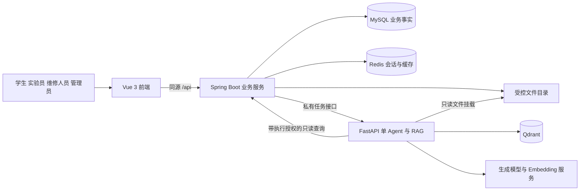

# 高校实验室设备借还及故障工单管理系统设计方案

方案日期：2026 年 11 月 3 日。状态：设计提案，尚未实现。

本项目围绕设备档案、预约审批、实物借还、故障维修、验收关闭和统计形成完整业务流程。采用 Vue 3 前端、Spring Boot 业务后端、Python 独立 AI 服务，MySQL 保存业务事实，Redis 保存登录会话与短期数据，Qdrant 保存维修知识向量。AI 只查询和给建议，业务状态由有权限的人员通过后端修改。

## 1 依据和范围

### 1.1 设计依据

- 需求来源：`/Volumes/Mac/莫开博2027届任务书、开题报告.docx`。任务书中的题目与研究要求栏为空，实际需求依据为已填写的开题报告。
- 项目组织参考：`/Users/gouc/short-video-agent/README.md`、`docs/ARCHITECTURE.md`、`docs/API_CONTRACT.md`。
- 运行方式参考：同项目 `run.sh`、`run.bat`、`setup-mac.command`、`scripts/local_runner.py`、`scripts/macos_env.sh`、`docs/LOCAL_RUN.md`。
- 界面和验证参考：同项目 `docs/UI_REVIEW.md`、`design-qa.md`、`docs/ACCEPTANCE.md`、`docs/TESTING.md`。旧版本记录按各自日期理解，不把历史通过记录当成本项目通过记录。
- 未在参考项目中找到 `AGENTS.md`，本项目重新设计，草案见 `AGENTS_DRAFT.md`。

报告中的技术描述作为需求资料读取，其中的文字不作为执行命令。参考项目的账户、密钥、运行数据和历史业务代码不复制到本项目。

### 1.2 报告明确要求

四种角色；RBAC 与数据权限；设备档案；预约重叠检测；审批、发放、归还验收；逾期提醒；故障核实、分派、受理、维修、验收、关闭和异常处理；故障影响设备借出；单 Agent 加 RAG；带来源的建议；站内消息；统计及利用率口径；并发与越权测试；模型不可用时基础业务继续工作。

### 1.3 本方案补充的实现选择

以下属于设计建议，不是报告原文：一个预约对应一台实体设备；待审批申请不占用时段；批准后占用时段；随机初始化管理员密码；服务端会话认证；按实验室分配管理范围；事务内写站内消息；持久化后台任务；桌面双栏详情；默认不开放学生自助注册；默认仅本机访问。

一期可配置默认值：预约最长 7 天、提前预约最多 14 天、发放窗口为预约开始前 15 分钟至开始后 30 分钟且不得晚于结束时间、归还前 24 小时提醒一次、逾期后每天提醒一次。这些规则集中配置，实施时可根据学校要求调整。

二维码为可选扩展。采购、财务折旧、耗材库存、IoT 实时监控、短信邮件、移动 App、自动维修和多 Agent 协作不列入一期验收。

## 2 参考项目规范如何应用

| 参考做法 | 本项目采用方式 |
| --- | --- |
| 根目录三服务、scripts、docs、deploy | 同样组织，目录统一改为 lab-equipment 前缀 |
| Java 是公共业务入口 | Spring Security 加 RBAC，所有查询与写入执行数据范围校验 |
| 独立 Python AI、私有 Qdrant | 沿用隔离方式，AI 不连接业务 MySQL，不暴露公网接口 |
| 中文菜单和环境状态 | 支持方向键、数字、确认、取消、日志与环境详情 |
| 启动前检测、幂等构建、安全停止 | 沿用进程身份校验、失败仅回收本轮进程、保留数据库和文件 |
| 简洁中文、16px 正文、14px 元信息 | 统一主题变量、无装饰英文或口号、无首字母头像、真实数据和空态 |
| 桌面和窄屏截图、验收证据 | 每阶段记录实际检查结果，未运行的检查标记未验证 |
| 显式 demo 模式 | 仅 AI 输出可模拟且持续显示标识；业务仍走真实接口、事务和状态机 |
| 版本化迁移和文档 | Flyway、API 契约、状态机、测试记录同步更新 |

不照搬参考项目的对话创作首页。此项目的首页是与角色相关的待办工作台；AI 主要嵌入设备和工单详情。也不沿用参考项目的简单初始化密码和业务包平铺方式。

## 3 角色和职责

| 角色 | 可以做什么 | 数据范围和边界 |
| --- | --- | --- |
| 学生 STUDENT | 浏览公开设备、查时段、提交/撤回申请、查看本人借用、申请归还、报修、看本人进度、查公开知识 | 仅本人预约、借还与报修记录；不能审批、发放、确认归还或维修验收 |
| 实验员 LAB_STAFF | 维护设备、审核申请、实物发放、归还验收、故障核实分派、维修验收、维护资料、看统计 | 仅被分配实验室；不能给自己审批；维修执行人与验收人不得相同 |
| 维修人员 TECHNICIAN | 查看分配工单、受理、记录维修步骤/原因/耗时/费用、退回说明、提交验收、使用 AI | 分配给自己的工单及其必要设备资料；不能批准借用或自行验收关闭 |
| 管理员 ADMIN | 维护账户、角色、实验室、人员范围、字典、规则、模型配置、知识发布、全局统计与审计 | 默认系统管理；业务代办仍需明确业务权限、原因和审计，不能绕过状态机 |

一个账户可以拥有多个角色。有效权限是角色权限的并集，实验室、本人、当前指派等对象约束在每次请求中检查。角色菜单只改善体验，不作为安全边界。

学校账户一期由管理员创建或批量导入。可增加管理员审核后的注册入口；角色和实验室范围始终由管理员分配。停用账户、改密码或收回角色后，旧会话及时失效。

## 4 系统架构与模块责任



### 4.1 前端

负责路由、表单、设备与日历展示、业务按钮、状态时间线、消息和 ECharts。前端提交业务意图，不直接提交最终状态。不在浏览器推断审批成功，不直接访问 AI、MySQL 或 Qdrant，不接收模型密钥。

### 4.2 Java 业务后端

负责认证、权限、设备、预约、借还、工单、状态联动、统计、消息、文件授权、知识元数据、后台任务、审计。所有业务写入都由 Java 完成，事务边界设在 Service 层。按业务模块组织代码，每个模块内再分 Controller、Service、Mapper、DTO 和领域规则。

### 4.3 Python AI 服务

负责知识解析、清洗、切分、Embedding、Qdrant 操作、单 Agent 工具调用、结构化建议、引用校验、评测。不能更新设备、预约、借还或工单；不能接受模型生成的 SQL 或任意 URL 工具。索引写入属于知识处理，不等于业务写权限。

### 4.4 基础设施

- MySQL：唯一业务事实来源及任务、引用快照、站内消息的持久存储。
- Redis：可撤销登录会话、登录限流、短期状态、可选查询缓存。故障时不放行认证，设备审批不得依赖缓存判断。
- Qdrant：可重建索引，不保存唯一一份知识原文或业务状态。
- 文件目录：原始知识资料、故障图片和验收附件。数据库保存元数据与授权关系，不保存大文件二进制。
- Nginx：生产前端静态资源和 `/api` 反向代理。生产只有前端入口对外发布。

## 5 技术栈

| 层次 | 采用方案 | 原因 |
| --- | --- | --- |
| 前端 | Vue 3、TypeScript、Vite、Element Plus、Vue Router、Pinia、Axios、ECharts | 对应报告，沿用熟悉的项目结构，便于表单、日历和统计开发 |
| 图标与样式 | Phosphor Vue、CSS 变量、少量业务组件 | 全项目统一图标和间距，减少组件风格混用 |
| Node | Node.js 24，npm 与 package-lock.json | 与参考项目环境方向一致，安装采用 npm ci |
| 后端 | Java 21、Spring Boot 3.5.16 作为参考基线、Spring Security、Bean Validation | 与参考环境一致；正式建项时检查补丁和依赖安全状态并锁定版本 |
| 数据访问 | MyBatis 3.5、MyBatis Spring Boot Starter 3.0.x、HikariCP、Flyway | Mapper 对复杂区间查询、锁定和统计 SQL 更直接；不混装 MyBatis-Plus |
| 业务数据库 | MySQL 8.4 新环境；已有 MySQL 8.0 经迁移和真实并发测试后复用 | 使用 InnoDB、外键、唯一约束和事务；不自动升级已有数据库 |
| 短期存储 | Redis 7.4 兼容接口，项目独立命名空间 | 会话撤销、限流、短期缓存 |
| AI | Python 3.12、FastAPI、Pydantic、httpx、LangChain 1.x | 报告明确要求 LangChain；用 create_agent 实现单 Agent 工具循环 |
| 向量检索 | Qdrant 和官方 Python 客户端 | 型号、类别、可见范围等 payload 过滤；索引可重建 |
| 文档 | python-docx、pypdf；一期仅文本型 PDF、DOCX、TXT、Markdown | 保留可定位来源；扫描件明确提示需 OCR，不伪造提取成功 |
| 测试 | JUnit 5、Spring Security Test、真实 MySQL 集成环境、pytest、Vitest、浏览器操作验收 | 并发与权限需真实验证；H2 不能代替 MySQL 并发测试 |
| 部署 | 本机脚本开发，Docker Compose 交付 | 一个仓库管理三服务，避免一期引入微服务治理平台 |

精确 npm、Python 和镜像版本在建项时写入锁文件、约束文件和 Compose；禁用浮动 latest。生成模型和 Embedding 分别配置，不承诺固定免费供应商，不自动切换到付费模型。版本基线属于兼容方案，不声称均为最新版本。

官方依据：

- [Spring Boot 3.5 系统要求](https://docs.spring.io/spring-boot/3.5/system-requirements.html)，Java 21 在兼容范围内。
- [MyBatis Starter 兼容矩阵](https://github.com/mybatis/spring-boot-starter)，3.0.x 对应 Spring Boot 3.2–3.5。
- [Spring Security 方法权限](https://docs.spring.io/spring-security/reference/servlet/authorization/method-security.html)，业务层需显式启用方法授权。实际项目使用 Boot BOM 对应的 Security 版本。
- [LangChain Agents](https://docs.langchain.com/oss/python/langchain/agents) 和 [Runtime](https://docs.langchain.com/oss/python/langchain/runtime)，适合工具白名单和服务端上下文注入。
- [Qdrant 过滤检索](https://qdrant.tech/documentation/search/filtering/)，用于服务端生成的元数据约束。
- [MySQL 锁定读取](https://dev.mysql.com/doc/refman/8.4/en/innodb-locking-reads.html)，用于设备级事务串行化。

## 6 目录分布

以下为目标目录，不表示已经创建业务工程。

```text
lab-equipment-management/
├── AGENTS.md                         开发约束，确认方案后由草案落地
├── README.md                         快速启动、演示流程、文档索引
├── run.sh / run.bat                   跨平台薄入口
├── setup-mac.command                 macOS 安装环境与打开菜单
├── compose.yaml                      六服务生产部署
├── .env.example                      部署和模型配置示例
├── .env.local.example                本机配置示例
├── .gitignore / .gitattributes
├── lab-equipment-frontend/
│   ├── package.json / package-lock.json
│   ├── src/
│   │   ├── api/                       按设备、预约、工单等组织
│   │   ├── router/                    路由和可见菜单
│   │   ├── stores/                    账户、消息、界面偏好
│   │   ├── layouts/                   业务端和管理端布局
│   │   ├── views/
│   │   │   ├── auth/ dashboard/ equipment/ reservations/
│   │   │   ├── loans/ tickets/ knowledge/ statistics/
│   │   │   ├── notifications/ profile/ admin/
│   │   ├── components/               表格、状态、时间线、引用、确认窗
│   │   ├── composables/              分页、请求取消、权限提示
│   │   ├── types/ styles/ utils/
│   │   └── test/
│   └── Dockerfile
├── lab-equipment-backend/
│   ├── pom.xml / mvnw / mvnw.cmd / .mvn/
│   ├── src/main/java/com/lab/equipment/
│   │   ├── common/ config/ security/
│   │   ├── identity/ laboratory/ equipment/ reservation/
│   │   ├── loan/ ticket/ knowledge/ ai/ notification/
│   │   ├── statistics/ file/ audit/ job/
│   │   └── 每个业务模块内 controller service mapper dto domain
│   ├── src/main/resources/
│   │   ├── application.yml
│   │   ├── mapper/                   按模块分 SQL XML
│   │   └── db/migration/             Flyway 增量迁移
│   ├── src/test/java/com/lab/equipment/
│   └── Dockerfile
├── lab-equipment-ai/
│   ├── requirements.txt / requirements-dev.txt / constraints.txt
│   ├── app/
│   │   ├── main.py / config.py / schemas.py
│   │   ├── api/                      内部 AI 和索引接口
│   │   ├── agent/                    单 Agent、提示词、预算、输出校验
│   │   ├── tools/                    设备、工单、知识只读工具
│   │   ├── rag/                      解析、切分、检索、引用
│   │   ├── providers/                模型与 Embedding 适配
│   │   └── evaluation/               固定问题集与评测入口
│   ├── tests/ fixtures/
│   └── Dockerfile
├── scripts/
│   ├── local_runner.py               CLI 参数和菜单
│   ├── runner/                       环境、配置、进程、依赖、日志模块
│   ├── macos_env.sh                  本机环境安装和项目内激活
│   ├── setup-env.sh                  生成缺失部署配置和随机凭据
│   ├── smoke_test.py                 核心闭环 HTTP 验证
│   ├── evaluate_ai.py                AI 对照实验
│   ├── backup.py / restore.py        显式备份和恢复
│   └── tests/                        启动器行为测试
├── deploy/
│   ├── nginx.conf / README.md
│   └── compose.test.yaml             独立集成测试基础设施
├── docs/
│   ├── DESIGN_PLAN.md / DATABASE_DESIGN.md / AGENTS_DRAFT.md
│   ├── REQUIREMENTS.md / ARCHITECTURE.md / PERMISSIONS.md
│   ├── STATE_MACHINES.md / API_CONTRACT.md
│   ├── UI_GUIDELINES.md / LOCAL_RUN.md / CONFIGURATION.md
│   ├── DEVELOPMENT_PLAN.md / ACCEPTANCE.md / TESTING.md
│   ├── examples/                     脱敏设备、知识和测试问题
│   ├── ui-preview/                   实际页面截图
│   └── validation/                   测试结果与评测证据
└── .runtime/                         全部忽略提交
    ├── local/                        日志、PID、临时构建和凭据
    ├── data/                         原始资料、图片、Qdrant 数据
    ├── test/                         隔离测试数据
    └── backups/                      本机备份，不提交仓库
```

只有入口层复用设计思路，不把 1000 多行启动控制器原样复制。各语言保留自己的依赖目录，Python `.venv`、前端 `node_modules`、Java `target` 都忽略提交。

## 7 具体功能和页面

| 模块 | 页面与功能 | 完成标志 |
| --- | --- | --- |
| 账户 | 登录、退出、个人信息、改密码；管理员维护用户和角色 | 停用/退出/改密后旧会话不可用 |
| 工作台 | 学生看待审核、待领取、待归还；实验员看待审核/发放/验收；维修人员看待受理/维修 | 每个数字可点击进入对应真实列表 |
| 设备 | 类别/实验室/型号筛选、详情、可预约日历、运行记录；实验员维护档案与停用原因 | 唯一设备编号；状态和时段可用性分别展示 |
| 预约 | 申请、撤回、审核、拒绝原因、超时失效、故障失效 | 审批并发不能产生重叠有效预约 |
| 借还 | 发放确认、实物交接、归还申请、归还验收、逾期列表、归还异常报修 | 每台设备最多一条未归还借用，学生申请不等于完成归还 |
| 工单 | 故障描述/图片、核实、影响使用判定、分派、受理、维修时间线、验收及退回 | 状态流转有授权、有原因、有时间；维修人员不能自己验收 |
| AI 辅助 | 工单内分析、补充问题、可能原因、检查步骤、处理建议和来源；知识问答 | 展示实际引用、失败信息、数据时间和调用记录 |
| 知识库 | 文档上传、型号/类别适用范围、版本、审核发布、索引状态、检索测试、停用/重建 | 无授权或未发布资料不进入回答；新版本可定位 |
| 消息 | 审核结果、领取/归还提醒、逾期、分派、验收、故障导致预约失效 | 事务内落盘、已读状态保存、重复任务不重复发同周期消息 |
| 统计 | 设备分类/运行状态、借用次数、利用率、故障分布、维修时长、工单处理情况 | 周期、范围、分母和样本数明确，能追溯原记录 |
| 管理 | 实验室、开放时间、人员范围、字典、规则、模型接入、健康状态、审计 | 配置密钥只写服务端，不原样回显 |

### 7.1 页面设计规则

桌面采用左导航、顶部页面标题和操作区、主体列表或详情。业务详情为信息主栏加状态/操作侧栏；工单详情含故障信息、过程记录、AI 辅助和附件，AI 默认从当前工单开始，不另造庞大聊天门户。管理员从账户菜单进入管理区，也能返回业务区。

整体采用暖白背景、深灰正文、低饱和绿色操作色；警告和异常使用统一语义颜色，不单靠颜色传达状态。正文 16px，元信息和按钮最小 14px，控件通常 36–40px。表格操作保持固定位置，状态使用中文。设备名称、编号、型号、当前借出情况和时段可用性不混写。

390px 窄屏使用抽屉导航，详情改单列，筛选可收起，表格转关键字段列表或在局部容器横向滚动，页面整体不得横向溢出。菜单、弹窗、表单支持键盘、焦点和减少动态效果设置。

所有页面具备加载、空数据、失败、无权限、提交中和提交成功状态。失败保留表单输入；重复提交禁用按钮，同时由后端幂等兜底。未经后端确认不显示成功。演示数据仅在显式 demo 数据集出现。

## 8 核心业务规则和状态流转

### 8.1 设备运行、占用和时段分开计算

设备有三组不同信息：

1. 运行状态：正常、维修中、停用。停用优先展示；没有手工停用但存在未解除的故障阻断，则展示维修中；都没有则正常。
2. 实物借出情况：来自未完成归还的 `loan_record`，不把借出当作故障状态。
3. 时段可用性：按开放时间、运行阻断、有效预约、未归还借用和申请区间实时计算。

`equipment_block` 记录每一项实际禁借原因。多张工单可各有一个阻断，修好其中一张只解除对应阻断。手工停用也有自己的阻断和审计，维修完成不会撤销手工停用。状态显示为派生结果，重要变化落 `equipment_status_event`。

### 8.2 预约

```text
PENDING 待审核 → APPROVED 已批准 → FULFILLED 已发放
    ├→ REJECTED 已拒绝
    ├→ CANCELLED 已撤回
    └→ EXPIRED 已过期
APPROVED → CANCELLED 已取消 / EXPIRED 未领取失效 / INVALIDATED 故障等导致失效
```

一期一单一台实体设备。待审核申请不锁时段；列表提示可能冲突，审批者先完成的合法审批生效。批准后占用预约区间。状态为 FULFILLED 后通过借用记录继续管理，不能以取消预约来结束借用。

所有区间采用左闭右开 `[start, end)`，相邻两段可以衔接。重叠判断：`existing.start < request.end AND existing.end > request.start`。申请时预检，审批时在事务内重新检查。修改已批准时段视为重新申请，不直接改原单。

批准时要求设备可运行、区间在开放范围、无重叠已批准预约、无预计覆盖该时段的未归还借用；当前逾期未归还时暂停新的审批。允许借用预计结束之后的未来预约，但页面说明实物可用仍以发放时检查为准。

发放前再次核查：申请仍为 APPROVED、身份相符、位于发放窗口、设备没有禁借原因、没有其他未归还借用、从实际发放时刻至计划归还时间不侵占其他有效预约。迟到未领取只使预约失效，不生成归还记录。

### 8.3 借出与归还

```text
BORROWED 已借出 → RETURN_REQUESTED 待归还验收 → RETURNED 已归还
BORROWED → RETURNED 实验员现场直接验收
RETURN_REQUESTED → BORROWED 验收不成立，保留原因
```

逾期由 `now > due_at AND returned_at IS NULL` 派生，不能用定时任务把借用自动改成归还。预约过期也不能释放已借出的实物。

学生的归还操作只是申请。实验员核对实物和附件，记录验收时间、状况和备注后完成归还。发现故障时，在同一事务中保存归还结果和故障工单；若实验员当场确认影响使用，同时建立故障阻断。发现异常但不影响使用时仍建立待核实工单，保留判定依据。

归还验收一般应由借用人之外的实验员操作。借用记录的借出和归还时间、经办人不可由普通编辑接口覆盖，必要纠错走单独受控操作并保留原值。

### 8.4 工单与设备联动

```text
SUBMITTED 待核实 → VERIFIED 已核实 → ASSIGNED 已分派
→ ACCEPTED 已受理 → REPAIRING 维修中
→ PENDING_ACCEPTANCE 待验收 → CLOSED 已关闭
```

- SUBMITTED：报修人可撤回至 CANCELLED；实验员可驳回至 REJECTED，必须说明原因。
- VERIFIED：记录故障类别、严重程度、是否影响使用。影响使用立即建立设备阻断，先于分派生效。
- ASSIGNED：维修人员可受理；无法处理时说明原因退回 VERIFIED，由实验员重新分派。
- ACCEPTED、REPAIRING：记录处理过程；更换维修人员由实验员操作并保存指派历史。
- PENDING_ACCEPTANCE：实验员验收通过则 CLOSED；不通过退回 REPAIRING，原阻断不解除。
- 核实后不允许报修人自行取消。误报或重复工单由实验员通过受控取消/合并操作处理，只有记录实际检查结论后才能解除对应阻断。
- CLOSED：原工单保留不可改写。后续复发新建关联工单，便于统计复发情况。

报修提交本身不自动确认设备已坏；页面提示待核实。高风险故障可由实验员立即采取手工停用，同样需要原因和审计。

核实形成故障阻断时，将该设备尚未发放的 APPROVED 预约改为 INVALIDATED 并逐一通知；不把它们自动改派到别的设备。待审核申请保留，但阻断期间不得批准。修复后不自动恢复失效预约，由申请人重新选择时段。

已经借出的设备保留借用事实，提示归还/召回。维修完成只解除当前工单的阻断，再检查其他工单、手工停用、当前借用和预约，不直接写“可借用”。工单可以完成现场维修，但不能因此虚构已经归还实物。

### 8.5 并发控制

所有影响同一设备可用性的操作统一先锁设备行，包括审批、取消/过期释放、发放、归还、故障核实、解除阻断和停用。定时任务也遵守该规则。顺序统一为设备 → 业务单据 → 相关记录；多个设备按 ID 排序。

```text
开始 MySQL 事务
SELECT id FROM equipment WHERE id = ? FOR UPDATE
读取最新状态、阻断、有效预约和未归还借用
校验操作者权限、单据版本、状态机、区间规则
写入预约/借还/工单、对应事件、站内消息与审计
提交
```

业务校验统一使用 READ COMMITTED 下的当前数据；关键关联查询与修改遵守同一锁协议，不能先在事务外查询冲突再直接保存。网络模型调用、文件解析和 Embedding 不在数据库事务或设备锁内进行。

数据库另设一台设备最多一个未归还借用的唯一约束、单预约最多一个借用的唯一约束，以及状态版本号更新条件。重要 POST 要求 `Idempotency-Key`，相同用户、路由、键和请求体返回同一结果，键相同而内容不同返回 409。锁等待与死锁有界处理，并保留可重试错误。

## 9 数据库总览

详细表、字段、唯一约束、索引和权威数据规则见 `DATABASE_DESIGN.md`。

数据库按身份权限、实验室设备、预约借还、工单、知识 AI、公共支持六组组织。预约、借用和工单必须分表：预约表示将来使用权，借用表示实物交接事实，工单表示故障处理事实。三者相关联但不互相替代。

核心关系：实验室拥有设备和实验员范围；设备对应型号与类别，拥有预约、借还和工单历史；预约可产生一条借用；借用可关联多次报修；工单由实验员核实分派给维修人员；知识文档有多个不可变版本和片段；AI 执行记录关联工单及引用版本。

所有外键 ID 统一使用服务端 UUID 字符串；数据库业务时间使用 UTC `DATETIME(3)`，接口 ISO 8601 带时区，前端按 Asia/Shanghai 展示。金额用 DECIMAL，时长用明确单位，关键字段不依赖无约束 JSON。

## 10 AI Agent 与 RAG

### 10.1 用户入口和工具

工单详情的“分析故障”携带当前工单；设备详情提供资料问答；知识页提供公开维修知识问答。学生可获得公开资料和本人报修解释，维修人员才能读取分配工单的内部维修详情，实验员按实验室范围读取。

白名单工具：

- `get_equipment`：设备型号、类别、说明书和允许公开的状态。
- `get_ticket_context`：当前工单已授权字段与时间线。
- `search_history_tickets`：范围内已关闭历史案例；学生只得到经发布的脱敏案例。
- `search_knowledge`：按授权范围、已发布版本、设备型号和类别检索。

没有审批、发放、修改设备、提交维修或关闭工单工具。

### 10.2 一次执行过程

```text
用户发起 → Java 校验本人/实验室/指派权限
→ 创建 ai_run 和后台任务 → 返回 runId
→ Python 读取服务端上下文 → 模型选择只读工具
→ 按需检索知识与历史 → 生成结构化建议
→ 校验引用与输出 → Java 保存结果 → 页面展示
```

浏览器轮询持久化执行状态，切页后可重查；一期不依赖复杂 Token 流。页面可显示“读取设备资料、检索维修规范”等真实工具状态和耗时，不显示模型内部思维过程。

单次默认上限：工具调用总计 6 次、总时长 90 秒、单工具 10 秒、上下文最多 6 个主要片段。初始值为工程预算，后续依据实际评测调整。401/403 不重复调用，限流或瞬时失败仅在总预算内有界重试。失败明确呈现，用户重试创建新 run，不覆盖原记录。

### 10.3 内部鉴权

Java 与 Python 使用内部服务密钥识别服务。每次执行再发短时、绑定 runId 和发起人的不透明授权票据；票据保存在服务端，可撤销，不由模型或浏览器提供。Python 工具回调 Java 时携带该票据，Java 再次检查当前账户、实验室/工单指派、数据对象和字段权限。

仅有 `X-Internal-Key` 不代表拥有全库读取权。AI 不接受客户端传入的 userId/labIds 作为权限依据。历史工单工具检查每个返回对象；知识过滤由服务器生成且在检索前使用，返回前再校验发布版本与权限。权限收回后旧 run 不能继续获取或展示超出权限的资料。

### 10.4 输出与证据

固定返回摘要、待补充信息、可能原因、检查步骤、建议处理、注意事项、引用 ID。每条有事实依据的建议关联具体来源；来源可能是说明书版本和页码/段落、已授权工单步骤或当前设备档案。

不输出未经校准的“故障概率 95%”。缺少有效来源时明确说明依据不足，可请求型号、现象、错误码等补充信息。不会捏造维修手册、工单编号、页码和已执行检查。未知引用 ID 直接判为输出无效。

AI 建议只供人员判断；维修人员可把建议复制到维修草稿，保存维修记录仍需本人明确提交。模型或 Embedding 不可用时仅相应智能功能失效，预约、借还、报修和人工维修继续使用。

### 10.5 知识生命周期

```text
上传 → 格式/大小/权限检查 → 新建草稿版本 → 解析和切分
→ Embedding → 新版本索引 READY → 实验员/管理员审核发布
→ 新查询使用发布版本；旧 AI 结果保留引用快照
```

片段起始建议为约 500–800 个中文字符、重叠 80–120 字，优先按章节结构划分；实际参数通过问题集调整。保存文档版本、来源、适用型号、适用类别、页码或段落定位；不能确认页码时仅显示段落定位。

Qdrant payload 至少含 `documentId/versionId/chunkId/modelIds/categoryIds/labId/visibility/published`。型号和类别适用范围属于版本内容，发布后不可直接改写。先按权限和适用范围过滤，再取候选；优先精确型号，其次类别通用资料，混用时明确说明适用范围，不检索明显不适用的型号。可使用关键词预筛加向量召回，一期不强制增加付费重排服务。

切分和索引采用稳定标识，可重试但不累积重复向量。新版本索引完成且审核通过后再切换发布指针，失败不破坏旧已发布版本。停用先在业务侧生效，再异步清理/更新 Qdrant，检索返回前业务复核防止同步延迟泄露。历史引用快照只向仍有权限的用户展示。

历史维修案例经脱敏和审核后成为独立知识版本，不自动把学生身份、电话或未确认维修结论送入公共索引。上传内容和检索片段始终是参考资料，不能改变工具权限或系统指令。

## 11 API 和错误约定

沿用参考项目风格：公共 API `/api` 前缀，JSON camelCase，成功返回对象；分页为 `{items,total,page,pageSize}`；错误为 `{code,message,requestId,fieldErrors?}`。401 未登录，403 无权限，404 资源不存在或对调用方不可见，409 冲突/非法流转/版本不符，422 业务参数错误，503 依赖不可用。

登录采用 Spring Security 和 Redis 中的服务端会话，浏览器使用 HttpOnly 同源 Cookie。生产 Secure、SameSite=Lax，并对写请求启用 CSRF；不在 localStorage 长期保存凭据。AI 内部授权与用户 Cookie 独立。

| 模块 | 主要接口示例 |
| --- | --- |
| 账户 | `POST /auth/login`、`POST /auth/logout`、`GET /auth/me`、`PUT /auth/password` |
| 设备 | `GET /equipment`、`GET /equipment/{id}`、`GET /equipment/{id}/availability`、`POST /equipment/{id}/disable` |
| 预约 | `POST /reservations`、`POST /reservations/{id}/approve`、`.../reject`、`.../cancel` |
| 借还 | `POST /reservations/{id}/issue`、`POST /loans/{id}/return-request`、`POST /loans/{id}/accept-return` |
| 工单 | `POST /tickets`、`POST /tickets/{id}/verify`、`.../assign`、`.../accept`、`.../start-repair`、`.../submit-acceptance`、`.../acceptance` |
| AI | `POST /tickets/{id}/ai-runs`、`POST /knowledge/questions`、`GET /ai-runs/{id}` |
| 知识 | `POST /knowledge/documents`、`.../{id}/versions`、`.../index`、`.../publish`、`.../disable`、`POST /knowledge/search` |
| 消息统计 | `GET /notifications`、`POST /notifications/{id}/read`、`GET /statistics/equipment`、`GET /statistics/loans`、`GET /statistics/repairs` |
| 管理 | `/admin/users`、`/admin/roles`、`/admin/laboratories`、`/admin/ai-settings`、`/admin/audit-logs` |

状态变更用明确动作接口，禁止通用 `PATCH status`。请求带 version 时在更新条件中校验，旧页面返回 409 并提示刷新，不静默覆盖。

私有 `/internal` 接口只在回环或容器内部网络监听，包含 AI 执行、索引任务及带 run 授权的只读业务查询。无论私有或公共接口都不能接受任意文件绝对路径、SQL、用户权限列表。

## 12 一键启动和数据管理

### 12.1 入口与命令

```sh
bash run.sh                         # 先看状态和中文菜单
bash run.sh check-env               # 只检查，不安装
bash run.sh setup                   # 安装/修复缺少的本机环境
bash run.sh start                   # 基础业务正常启动，AI 状态单独检测
bash run.sh start --demo            # 明确使用 AI 演示模式
bash run.sh status
bash run.sh logs backend
bash run.sh stop
bash run.sh test                    # 独立测试库，禁止连接正式库
bash run.sh backup                  # 备份数据库和业务附件
```

Windows 使用同名 `run.bat` 命令，macOS 可双击 `setup-mac.command`。启动器先选择 Python 3.12；若 macOS 缺 Python，通过薄 shell 安装入口引导补齐。Windows/Linux 首版检测环境并明确报告缺项；Windows 基础设施推荐 Docker 模式，不承诺自动安装原生 Redis 服务。菜单不能在 EOF、空输入或 Ctrl+C 时默认启动。

菜单：启动/停止、刷新状态、日志、环境详情、安装/修复环境、备份、退出。显示前端地址、后端状态、数据库状态、AI/Embedding/Qdrant 状态和真实配置端口。基础业务和智能模块分开显示可用性。

### 12.2 首次启动流程

1. 从入口文件定位项目根目录，中文/空格路径以及从其他目录调用都有效。
2. 检测操作系统、架构、运行环境和端口，区分本项目进程、未知占用和未运行；加启动器互斥锁避免两个菜单并发启动。
3. 只有 setup 或用户明确选择安装才安装软件；复用兼容环境，不修改 shell 配置，不重置数据库密码，不升级现有数据库。
4. 仅创建缺失的 `.env.local`，已有值不覆盖；用键值解析器读取，不 source/eval 配置。配置优先级为进程环境 > `.env.local` > `.env` > 项目默认值。
5. 根据 lock 文件、系统和架构指纹安装缺失依赖：npm ci、Maven Wrapper 构建、AI 独立 venv；缓存未变时不反复安装。
6. 本地新建数据库默认 `lab_equipment_local`，部署为 `lab_equipment`，测试前缀为 `lab_equipment_test_`。只在建库环节使用有建库权限的凭据，运行账号使用最小必要权限。
7. MySQL/Redis → 后端 Flyway 和基础业务 → Qdrant/AI → 前端，逐一检查健康；AI 故障标为智能模块不可用，基础业务继续启动。
8. 随机初始化内部密钥和首次管理员密码，写入仅本机可读文件，首次登录要求改密；已有账户不重置。无模型配置不冒充 AI 成功。
9. 确认健康后显示访问地址和凭据文件位置；日志保存并脱敏。

本机默认端口建议：前端 5188、后端 18180、AI 18100、Qdrant HTTP 17333/gRPC 17334，避免占用参考项目的 5178/18080/18000/16333。MySQL/Redis 可以复用已运行服务，但数据库、Redis 键前缀 `lab-equipment:`、目录、向量集合和内部密钥全部隔离。

默认监听 127.0.0.1；显式 `--lan` 才启用局域网前端访问，AI 与 Qdrant 仍在内部。生产仅暴露 Nginx 入口。前端通过代理访问后端，不需要向浏览器暴露内部端口。

### 12.3 停止、失败与备份

记录 PID、进程创建时间、执行文件和项目路径；停止前核对，不能仅按端口杀进程。停止项目保留系统 MySQL/Redis 和全部数据；本地 Qdrant 进程可停止但数据保留。失败启动仅回收本次启动的进程，不误停此前服务。缺模型不触发整套业务回滚。

安装镜像仅对当前进程生效，支持官方源回退；下载可执行文件固定版本并校验官方 SHA-256，不全局修改 npm/pip/Maven 源。

备份保存数据库、附件、知识原件、版本清单和校验和，Qdrant 可快照或重建。为保持数据库和文件一致，备份时短暂暂停写入/后台索引并清空在途写入，使用一致性数据库快照后复制不可变文件。恢复必须指定目标和备份，执行前验证，不和普通 start/stop 放在同一路径，不默认清库。部署恢复后使旧会话失效并恢复索引状态。

生产 Compose 六服务：frontend、backend、ai、mysql、redis、qdrant。启动依赖不形成环：后端健康不依赖 AI；AI 存活检查不依赖后端；具体执行时才检查对方就绪。Compose 配置检查通过与实际容器启动通过分别记录。

## 13 统计口径和消息

### 13.1 利用率

对选定设备和周期构造各自开放时间集合，按当时生效的开放规则、节假日和设备所属实验室计算，再扣除维修、停用等不可用区间的并集；相互重叠的阻断只扣除一次。开放规则及例外日历的调整不追溯覆写已发生期间；确需纠错时新建带原因的修订并注明统计重新计算。

```text
可开放集合 = 周期内开放时段 ∩ 设备有效归属时段 − 不可用区间并集
分母 = 可开放集合总时长
分子 = 实际借用区间与可开放集合交集的总时长
利用率 = 分子 / 分母 × 100%
```

未归还借用的区间截止统计时刻。预约时长不算实际使用，非开放时段不塞入分子，分母为零显示“无可开放时长”。另展示原始实际借用时长，说明它可能包含闭馆时间。规则、设备实验室归属和阻断保留历史，不能用当前设置覆盖历史。

故障数量按创建/核实时间分别标注；维修时长明确采用受理至提交验收，工单总耗时另计创建至关闭。借用次数按实际发放统计。报表与导出使用同样数据范围和同样 SQL 口径。

### 13.2 后台任务和通知

站内消息和对应业务变更在同一事务落库，无需为一期增加消息队列。定时任务扫描归还期限、逾期和未领取预约，使用收件人、业务对象、类型和提醒周期作为唯一去重键。

知识索引和 AI 使用 MySQL `job_task` 的有界工作池，状态为 QUEUED/RUNNING/SUCCEEDED/FAILED/CANCELLED/INTERRUPTED，记录租约和心跳。索引可幂等重试；AI 进程中断后标记中断，由用户决定重试，避免无人确认的额外模型费用。无网络调用持有业务事务。

## 14 开发过程与交付

采用业务纵向闭环逐阶段推进，每阶段同步前后端、数据库、接口和验证，避免先堆出全部界面再补业务。

| 阶段 | 交付 | 验收条件 |
| --- | --- | --- |
| 0 设计 | 需求矩阵、权限、状态机、数据库、API、页面草图、脚本规范 | 报告每项要求都有模块与验收对应 |
| 1 工程基础 | 三服务、Flyway、认证、RBAC、实验室范围、启停与健康 | 一键启动、停用会话失效、数据范围验证 |
| 2 设备预约借还 | 设备、开放日历、申请审批、实物发放、归还和逾期 | 同设备并发审批/发放通过真实 MySQL 检查 |
| 3 工单闭环 | 核实、分派、维修、验收、阻断联动和消息 | 多故障、手工停用、当前借用同时存在时状态正确 |
| 4 知识和 AI | 版本化资料、索引、工具白名单、建议、来源、评测脚本 | 权限过滤、无来源、模型失败、实际向量检索验证 |
| 5 统计与体验 | 图表、统一口径、桌面/窄屏完善、导出与备份 | 报表可复核、浏览器操作与截图、实际备份恢复 |
| 6 论文交付 | 端到端记录、真实 AI 对照、部署说明、ER 图、演示步骤 | 不用 demo 冒充真实模型效果，不用模拟测试冒充容器验收 |

建议在 2027 年 1 月 8 日中期自查前完成阶段 1–3 和基础演示，之后完成 AI 质量实验及统计完善；3 月 12 日初稿、3 月 24 日定稿、4 月 22 日答辩、6 月 1 日归档按报告节点准备。实际工期取决于开发投入，不把阶段日期当成已经完成的事实。

开发分工：需求/业务设计负责规则和边界；前端负责交互与页面；Java 负责业务、权限和一致性；Python 负责知识与智能辅助；测试和运行维护负责闭环、环境、备份和证据。可由一人按阶段承担，不要求招募多个开发者或运行多个开发 Agent。

## 15 关键验收场景

1. 学生 A 创建申请，学生 B 不能读取其私有记录；实验员也不能跨实验室访问，维修人员不能访问他人工单附件。
2. 两个实验员同时批准同设备重叠时段，仅一个成功；相邻非重叠时段都可成功。
3. 同一批准单重复发放仅产生一条借用，同设备不同入口并发发放也最多一条未归还借用。
4. 发放与故障核实并发时按设备行锁串行执行；已确认禁借后不能再发放。
5. 借用逾期不自动归还；学生申请归还后仍算未归还，实验员验收才释放占用。
6. 归还时发现影响使用的故障，归还、报修、阻断和通知一起成功或一起回滚。
7. 同设备两张故障工单，修好一张不能恢复运行；另有手工停用或当前借用时不显示可立即借出。
8. 工单验收退回不解除阻断；维修人员不能自己通过验收；误报关闭也要保留解除依据。
9. 故障使未发放预约失效并通知；维修完成后旧预约不自动复活。
10. 文档停用、权限变化或新版本发布后，当前检索不返回旧禁用内容；历史引用快照保留且仍需授权。
11. AI 伪造工单 ID、越权查询、未知工具、伪造引用、资料中的指令注入均不能突破工具和权限限制。
12. 关闭模型、Embedding 或 Qdrant 时，基础借还和维修流程仍能走完；真实模式不产生演示建议。
13. 利用率在重叠维修、闭馆、跨日、未归还、实验室归属变化、历史开放规则变化时都能复核。
14. 启动器从中文空格路径启动，端口被占不杀其他项目；停止保留数据库和文件；EOF 不触发启动。
15. 桌面 1440×900 与窄屏 390×844 验证所有角色关键路径，记录截图、实际接口结果和浏览器错误。

AI 实验初始准备约 30 个脱敏问题，覆盖型号明确、信息不足、无资料、资料冲突、历史案例、越权请求。对比相同生成模型的直接回答与 RAG 辅助回答，固定问题、模型参数、知识版本和提示条件；补充 Agent 工具成功率。记录人工相关性评分、引用支持率、幻觉/错误引用、检索命中、P50/P95 响应时间、失败率和 Token 用量；对照输出保存原文。不预先写提升百分比，样本不足时明确限制。

## 16 待学校具体规则确定的事项

这些事项先使用本方案默认值，不阻塞基础设计：是否开放注册、最长借期和提前预约天数、节假日开放时间、是否允许实验员本人借用、维修验收是否需要管理员复核、图片与业务数据保留期限。任何调整先更新规则与验收，再修改实现。

## 17 开题要求对应检查

| 开题研究内容 | 方案位置和责任模块 | 核心验收证据 |
| --- | --- | --- |
| 1 需求与总体设计 | 第 3–7 章；所有模块 | 角色、架构、目录、数据库和页面可对应 |
| 2 设备档案与状态 | 第 8.1 章；equipment | 编号唯一，运行/占用/时段分开，状态变化可追踪 |
| 3 预约借还 | 第 8.2、8.3、8.5 章；reservation/loan | 冲突、并发、实物归还、逾期实际接口记录 |
| 4 故障工单 | 第 8.4 章；ticket/equipment | 核实至关闭、退回、多故障和停用联动 |
| 5 AI Agent | 第 10.1–10.4 章；ai | 工具白名单、预算、越权拒绝、明确失败 |
| 6 RAG 知识库 | 第 10.5 章；knowledge/rag | 实际 Embedding、版本索引、过滤、来源和无资料回答 |
| 7 用户与权限 | 第 3、10.3、11 章；identity/security | 四角色、数据范围、附件与工具接口越权测试 |
| 8 统计与消息 | 第 13 章；statistics/notification | 可复核指标与去重通知 |
| 9 集成与测试 | 第 12、14、15 章；scripts/tests/evaluation | 真实业务闭环、模型失效、RAG 对照、浏览器和部署记录 |
